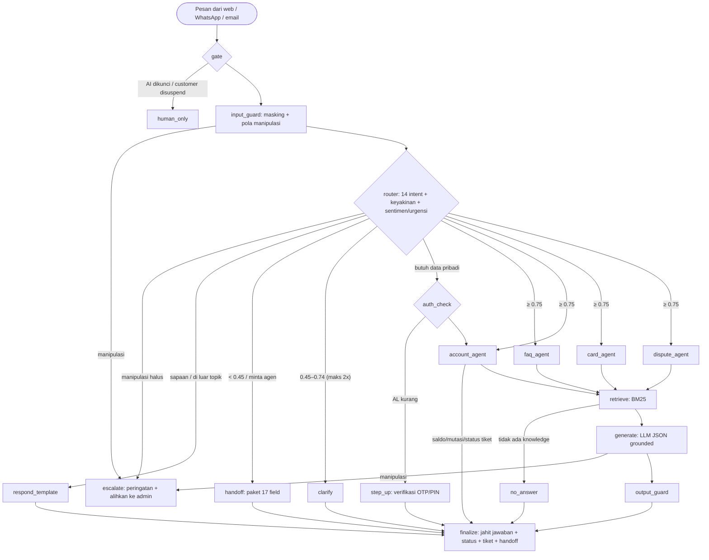

# V-TEKI Workspace - Chatbot Layanan Pelanggan (Gemini + LangGraph)

Prototipe *Platform Layanan Pelanggan & Penyelesaian Keluhan Berbasis AI Agentik*. Stack: **FastAPI + SQLite + LangGraph + LLM (Gemini default; Anthropic/OpenAI/Ollama lewat adapter)**. Knowledge base saat ini memakai dokumen `knowledge/BCA_Knowledge_Base_Customer_Service.md`.

Kesesuaian dengan *Dokumen Spesifikasi Kebutuhan Sistem* dirangkum di [bagian 0](#0-kesesuaian-dengan-dokumen-spesifikasi).

> **Penting:** ini prototipe independen, **bukan kanal resmi BCA**, dan tidak terhubung ke sistem bank. Persetujuan admin hanya mengubah status demo; tidak ada kartu yang diblokir atau uang yang dipindahkan.

## 0. Kesesuaian dengan dokumen spesifikasi

Fitur dibangun di stack yang sudah ada (keputusan tim: **fitur dulu, stack tetap**). Komponen infrastruktur yang disebut spesifikasi dibuat sebagai *adapter* agar bisa diganti tanpa mengubah alur.

| Spesifikasi | Implementasi | Bukti uji (`tests/spec_test.py` kecuali disebut lain) |
|---|---|---|
| **§3.1** Sesi dimulai **AL0 (Anonim)** | Tombol *Chat sebagai tamu* / *Simulator WhatsApp* → `POST /api/auth/guest` | "sesi tamu dimulai AL0" |
| §3.1 FAQ dijawab RAG tanpa verifikasi | FAQ Agent (retrieve → generate → output_guard) berjalan di AL0 | "AL0: FAQ dijawab RAG bersumber" |
| §3.1 Data pribadi (mis. status keluhan) → **AL2 via OTP** | `auth_check` → `step_up`; tamu menyebut nomor HP terdaftar → OTP → sesi ditautkan ke nasabah | "AL0: cek status keluhan → AL2", "tamu + OTP → AL2" |
| §3.1 **OTP gagal 3x berturut-turut → sesi dikunci 15 menit & dialihkan ke agen** | `identity.confirm_otp` (penghitung per sesi) + `_handoff_case` | "OTP gagal 3x … dikunci", "… dialihkan otomatis" |
| AL1/AL3 (pelengkap) | AL1 = login sandi; AL3 = AL2 + PIN transaksi untuk tindakan berisiko | `routing_auth_test.py` |
| **§3.2 14 taksonomi intent** | `app/taxonomy.py` (14 kode + `di_luar_topik`, `minta_agen`) | "taksonomi berisi tepat 14 intent", contoh per intent |
| §3.2 Keyakinan **≥ 0.75** → tiket CRM & resolusi | Router → sub-agent; `finalize` meminta tiket → `crm.create_or_update_ticket` | "keyakinan ≥ 0.75 → tiket" |
| §3.2 **0.45–0.74** → klarifikasi terarah maks. **2** giliran | Node `clarify` (opsi dari intent alternatif), `cases.clarify_count` | "klarifikasi … maks. 2", "klarifikasi ke-3 → handoff" |
| §3.2 **< 0.45** → handoff | Node `handoff` | "keyakinan < 0.45 → handoff" |
| **§3.3** Bukti ke zona **karantina** | `app/evidence.py`: `storage/quarantine` → `storage/clean` (pola kunci S3/MinIO) | "unggah bukti diterima ke zona karantina" |
| §3.3 Pemindaian **ClamAV** asinkron; terinfeksi ditolak | `clamd` INSTREAM bila `CLAMAV_HOST` diisi, pemindai bawaan sebagai cadangan (EICAR, eksekusi, makro, JS di PDF, tipe isi palsu); `BackgroundTasks` | "pemindaian async …", "berkas terinfeksi dihapus" |
| §3.3 Teks bukti untuk agen; **berkas mentah tidak masuk prompt LLM** | Teks hasil ekstraksi hanya di Workspace agen; Copilot & chat tidak membacanya | "isi berkas bukti TIDAK PERNAH masuk prompt LLM" |
| **§3.4** Paket konteks **17 field** | `crm.build_handoff` (`HANDOFF_FIELDS`) — ringkasan, intent, transkrip, status AL, rekomendasi, dll. | "paket handoff berisi tepat 17 field" |
| §3.4 Antrean agen + **SLA jalan/berhenti sesuai kalender kerja** | Menu *Antrean Handoff* (urut prioritas); SLA jam kerja WIB, jeda saat *Menunggu Nasabah*, hari libur dilewati | "antrean … Kritis lebih dulu", uji SLA Jumat→Senin & libur |
| §3.4 **Copilot**: draf divalidasi agen sebelum dikirim | `POST /api/admin/cases/{id}/copilot` → draf masuk kotak balasan, tidak terkirim otomatis | "Copilot memberi draf …" |
| Router Agent (intent, sentimen, cek identitas, guardrail) | Node `router` + `input_guard`/`escalate` + `auth_check` | `routing_auth_test.py` bagian 1 |
| Account Agent (saldo, mutasi, **ekstraksi parameter**, transaksi gagal) | `node_account_agent` + `taxonomy.extract_tx_query` ("minggu lalu", "3 transaksi", "ke Andi", "di atas 500 ribu") | "Account Agent: ekstraksi parameter …" |
| Card Agent (**blokir seketika**, tertelan, aktivasi, limit) | `node_card_agent` → `identity.block_cards` (AL2); limit → persetujuan AL3 | "Card Agent: blokir darurat seketika" |
| FAQ Agent (RAG bersumber, anti-halusinasi) | BM25 + `generate` JSON grounded + `output_guard` | `smoke_test.py`, `knowledge_switch_test.py` |
| Dispute & Escalation Agent (fraud, sanggahan, sentimen/urgensi, ringkasan, handoff) | `node_dispute_agent` + tiket + paket handoff | "sentimen & urgensi terdeteksi", "Dispute Agent: status tiket" |
| UC-03 Tiket CRM + **state machine & closure checklist** | `crm.TRANSITIONS`, `crm.close_ticket` (checklist + akar masalah + identitas sesuai intent) | "transisi tidak valid ditolak", "penutupan tanpa checklist ditolak" |
| UC-07 Dasbor SLA, **analitik akar masalah**, **QA sampling** | Menu *Analitik SLA & QA* (`/api/admin/analytics`, `/api/admin/qa/*`) | "analitik …", "sampling QA …" |
| Kanal: Web Chat, **WhatsApp Simulator**, **Email** | Sesi tamu `channel=whatsapp`; `POST /api/channels/email/inbound` (menu *Simulator Email*) | "simulator WhatsApp …", "kanal email …" |
| Rate limiter, anti-prompt-injection guardrails | `app/ratelimit.py` (antarmuka siap Redis); `guardrails.py` | "rate limiter …", `routing_auth_test.py` |
| Aktor: Agen Manusia vs Supervisor/Admin | `agen@vteki.id` (workspace, tiket, handoff) vs `admin@vteki.id` (plus knowledge, guardrail, persetujuan, analitik/QA, audit) | "agen manusia tidak bisa membuka analitik …" |
| LLM OpenAI/Anthropic (cadangan Ollama) | `app/llm.py`: `LLM_PROVIDER` + `LLM_FALLBACK_PROVIDERS` (gemini · anthropic · openai · ollama) | uji manual rantai cadangan |

**Belum mengikuti spesifikasi (sengaja ditunda, disiapkan lewat adapter):** React + TypeScript + Tailwind (frontend masih HTML/JS), PostgreSQL 16 + pgvector (masih SQLite + BM25), Redis + Celery (rate limiter memori & `BackgroundTasks`), MinIO (folder lokal berpola kunci S3), container ClamAV + Docker Compose (klien `clamd` sudah ada; isi `CLAMAV_HOST`), WhatsApp/Email sungguhan (masih simulator).

## Yang baru di versi 2

| Fitur | Ringkasnya |
|---|---|
| **Knowledge dari file** | Unggah `.md`, `.txt`, `.pdf`, `.docx` (bisa banyak sekaligus, drag & drop). Dokumen dipecah otomatis per judul `##`/`###` menjadi bagian kecil lengkap dengan kategori, kata kunci, URL sumber, dan validitas. |
| **Versi dokumen** | Unggah file dengan nama sama = versi baru (bagian lama diganti). File identik dilewati. Ada pratinjau, unduh, indeks ulang, aktif/nonaktif per dokumen atau per bagian. |
| **Folder `knowledge/`** | File di folder ini otomatis diimpor saat backend start (bila baru/berubah). File yang dihapus dari folder → dokumennya otomatis **Nonaktif** (tidak dihapus); dikembalikan → aktif lagi. |
| **Jawaban tidak sembarangan** | Pencarian BM25 + stemmer bahasa Indonesia + ambang skor. Gemini wajib mengembalikan `grounded` + `source_ids`; jika tidak ada sumber → AI bilang belum tahu dan tiket diteruskan ke agen. Sumber jawaban tampil di chat. |
| **Guardrail anti-manipulasi** | Deteksi prompt injection, jailbreak, roleplay, klaim admin, tag sistem palsu, teks tersamar (spasi/leetspeak/zero-width) + klasifikasi Gemini. Jika terdeteksi: AI berhenti, customer diberi **peringatan**, percakapan **langsung dialihkan ke admin** & dikunci, admin dinotifikasi. Setelah 3 peringatan, AI dinonaktifkan untuk customer tsb. |
| **Output guard** | Jawaban AI diblok bila menyebut nomor/URL yang tidak ada di knowledge, meminta OTP/PIN, mengaku sudah memblokir/refund, atau membocorkan instruksi. |
| **Masking data rahasia** | OTP, PIN, password, CVV, dan nomor kartu (cek Luhn) disamarkan sebelum disimpan atau dikirim ke Gemini. |
| **Routing LangGraph** | Lihat diagram di bawah. Rute tiap pesan terlihat oleh admin di halaman Kasus. |
| **Autentikasi AL0-AL3** | Customer membuktikan dirinya (OTP, PIN transaksi) sebelum melihat saldo/mutasi atau mengajukan tindakan berisiko. Lihat bagian 4b. |

## 1. Instalasi (Windows)

Paling mudah: klik dua kali **`setup.bat`**, isi `GEMINI_API_KEY` di `backend\.env`, lalu klik **`start_all.bat`**.

Manual:

```powershell
cd backend
py -m venv .venv
.\.venv\Scripts\Activate.ps1
pip install -r requirements.txt
Copy-Item .env.example .env     # lewati jika .env sudah ada
.\.venv\Scripts\python.exe -m uvicorn app.main:app --reload
```

Terminal kedua: `cd frontend` lalu `py -m http.server 5500`, buka http://127.0.0.1:5500.

> **Upgrade dari versi lama:** cukup jalankan ulang `pip install -r requirements.txt` (ada paket baru: `langgraph`, `python-multipart`, `pypdf`, `python-docx`, `PySastrawi`). Database lama dimigrasi otomatis: kasus, pesan, dan audit tetap utuh; artikel lama (demo Bank Nusantara dan impor teks satu-blok) dijadikan **Draf** dengan kategori "Arsip lama" — tidak dihapus.

## 2. Akun demo

| Peran | Email | Kata sandi |
|---|---|---|
| Supervisor / Admin | `admin@vteki.id` | `admin123` |
| Agen manusia | `agen@vteki.id` | `agen1234` |
| Tamu (AL0) | - | tombol **Chat sebagai tamu** / **Simulator WhatsApp** di halaman masuk |
| Customer | `customer@vteki.id` | `cust1234` (HP demo `081234567890`, **PIN transaksi `246810`**, rekening demo saldo Rp 12.450.000, kartu debit •••• 4321 & kredit •••• 8765) |

## 3. Mengelola knowledge

1. Login Admin → **Basis Pengetahuan**.
2. Seret file ke kotak unggah (atau klik *Pilih file*). Klik **Pratinjau pemecahan** untuk melihat hasil pecahannya sebelum disimpan, lalu **Unggah**.
3. Klik dokumen untuk melihat bagian-bagiannya; tiap bagian bisa diedit (judul, kategori, jenis, status, validitas, URL sumber, kata kunci, isi).
4. Gunakan **Uji pencarian** untuk memastikan pertanyaan customer menemukan bagian yang benar sebelum dipakai.

**Agar dokumen baru terbaca baik**, ikuti pola file BCA:

```markdown
# Judul dokumen
**Organisasi:** Bank BCA                        ← nama organisasi di sapaan & prompt AI (opsional; bila tidak ada ditebak dari judul "... Bank X", bisa diubah lewat tombol Organisasi)
**Tanggal penyusunan:** 28 Oktober 2026        ← dibaca sebagai tanggal pemeriksaan
**Sumber utama:** https://...                   ← URL sumber default

## 0. Instruksi untuk AI Agent                  ← otomatis jenis "instruksi" (panduan perilaku AI)
## 2. Kanal bantuan resmi
### Halo BCA                                    ← tiap ### jadi satu bagian
## 7. FAQ
### Q1. Bagaimana cara menghubungi Halo BCA?    ← satu pertanyaan = satu bagian
## 9. Metadata yang disarankan untuk database   ← otomatis jenis "metadata" (tidak dipakai)
```

Jenis bagian:
- **fakta** - dicari & dipakai untuk menjawab.
- **instruksi** - judul seperti "Instruksi untuk AI", "Jika jawaban tidak ditemukan"; ditambahkan ke prompt sebagai panduan (tidak bisa mengalahkan aturan inti).
- **metadata** - disimpan, tidak pernah dipakai.

Bagian bertanda *dinamis* (biaya, limit, nomor, ketentuan) membuat AI mengingatkan customer untuk memverifikasi di sumber resmi.

## 4. Routing LangGraph: Router Agent + sub-agent



| Intent (contoh) | Sub-agent | Hasil |
|---|---|---|
| Info produk terjawab dengan sumber | FAQ | Selesai otomatis |
| Info produk tanpa knowledge / jawaban diblok | FAQ | Menunggu agen + handoff |
| Cek saldo · mutasi · status tiket | Account / Dispute | AL2+: data tampil (tidak disimpan & tidak ke LLM) · di bawah AL2: diminta verifikasi |
| Transaksi gagal · keluhan · sanggahan | Account / Dispute | Tiket + Menunggu agen + handoff |
| Penipuan · kartu hilang | Dispute / Card | Tiket **Kritis** + handoff; kartu hilang di AL2 → **diblokir seketika** |
| Ubah limit · refund · ubah data | Card / Account | Menunggu persetujuan; tombol *Setujui* aktif setelah nasabah **AL3** |
| Keyakinan 0.45–0.74 | Router | Pertanyaan klarifikasi (maks. 2x), lalu handoff |
| Keyakinan < 0.45 / minta CS manusia | Router | Handoff ke agen |
| Upaya manipulasi AI | — | **Dialihkan ke admin** (AI dikunci di kasus itu) |

## 4b. Tingkat autentikasi customer (AL0–AL3)

| Level | Cara mencapai | Boleh | Masa berlaku |
|---|---|---|---|
| **AL0** Anonim | sesi tamu (web chat / simulator WhatsApp / email) | FAQ dari knowledge; data pribadi → diminta verifikasi | selama sesi |
| **AL1** Login akun | email + kata sandi | info umum dari knowledge, membuat & melihat tiket sendiri | selama sesi |
| **AL2** Terverifikasi OTP | AL1 + kode OTP 6 digit ke nomor HP terdaftar | lihat **saldo & mutasi rekening milik sendiri** | 15 menit |
| **AL3** Terverifikasi kuat | AL2 + PIN transaksi | ajukan tindakan berisiko (blokir, ubah data, refund) yang **bisa disetujui admin** | 5 menit |

Cara pakai (customer): tanya "Berapa saldo rekening saya?" → AI meminta verifikasi → klik **Verifikasi identitas** (atau lencana 🛡 AL di kanan atas) → **Kirim kode OTP** → masukkan kode → pertanyaan dikirim ulang otomatis dan saldo tampil. Untuk "Tolong blokir kartu saya", lanjutkan ke langkah PIN (AL3); tanpa AL3 tombol **Setujui** di menu Persetujuan admin terkunci.

Pengaman yang diterapkan:
- Level disimpan **per sesi login** di server, bukan dari isi chat. Klaim "saya sudah terverifikasi" di chat tidak berpengaruh; logout/login ulang kembali ke AL1.
- OTP & PIN dimasukkan di dialog khusus, **tidak pernah lewat chat** dan tidak dikirim ke Gemini. OTP & PIN disimpan sebagai hash.
- OTP terikat ke sesi yang memintanya, berlaku 3 menit, maks. 3 permintaan per 10 menit. **Salah 3x berturut-turut → verifikasi sesi dikunci 15 menit dan percakapan otomatis dialihkan ke agen** (spesifikasi §3.1).
- Tamu (AL0) memverifikasi dengan menyebut nomor HP terdaftar; respons untuk nomor tidak terdaftar dibuat sama (tidak membocorkan apakah nomor terdaftar). Setelah OTP benar, sesi & percakapan tamu ditautkan ke akun nasabah.
- PIN salah 3x → verifikasi PIN dikunci 15 menit, verifikasi sesi dicabut, admin dinotifikasi.
- Data rekening dibaca kode langsung dari database (node `account_data`), **tidak pernah dikirim ke Gemini**, nomor rekening disamarkan, dan **tidak disimpan di riwayat chat** (riwayat hanya menyimpan penanda; admin pun tidak melihat saldonya).
- Setiap verifikasi & akses saldo tercatat di Audit Trail.

> **Mode demo:** tanpa SMS gateway, kode OTP ditampilkan di layar (`OTP_DEMO_MODE=true`). Rekening & transaksi adalah data fiktif (tabel `bank_accounts`, `bank_transactions`). Untuk produksi: set `OTP_DEMO_MODE=false`, kirim OTP lewat SMS/WhatsApp gateway, dan ganti data demo dengan integrasi core banking.

Status "menunggu" tidak turun kembali ke "Selesai otomatis" hanya karena customer bertanya hal lain.

## 5. Guardrail — alur untuk admin

- Menu **Guardrail** menampilkan semua kejadian (pola manipulasi, deteksi AI, jawaban AI yang diblok, data rahasia yang disamarkan) dan daftar customer yang punya peringatan.
- **Konfirmasi** = deteksi benar. **Salah deteksi** = peringatan customer dikurangi dan AI di kasus itu aktif lagi.
- **Pulihkan akses AI & reset peringatan** untuk customer yang telah mencapai batas.
- Di **Kasus & Percakapan**, tombol **Aktifkan AI kembali** membuka kunci AI untuk satu kasus.

## 6. Konfigurasi (`backend/.env`)

| Variabel | Default | Fungsi |
|---|---|---|
| `ORG_NAME` | `BCA` | Nama organisasi **cadangan**. Nama utama diambil otomatis dari dokumen knowledge yang aktif (lihat bagian 3), jadi ikut berganti saat knowledge diganti. |
| `LLM_CLASSIFIER` | `true` | Klasifikasi + deteksi manipulasi dengan Gemini (1 panggilan tambahan/pesan). `false` = hemat kuota, aturan pola saja. |
| `KB_MIN_SCORE` | `3.0` | Ambang relevansi. Naikkan jika AI memakai bagian yang kurang cocok; turunkan jika terlalu sering "belum tahu". |
| `KB_SCORE_REF_DOCS` | `20` | `KB_MIN_SCORE` berlaku penuh bila bagian aktif ≥ angka ini; untuk knowledge lebih kecil ambang diturunkan proporsional agar dokumen kecil tetap bisa menjawab. |
| `KB_TOP_K` | `4` | Jumlah bagian maksimum yang dikirim ke Gemini. |
| `GUARDRAIL_MAX_STRIKES` | `3` | Batas peringatan sebelum AI dinonaktifkan untuk customer. |
| `KNOWLEDGE_AUTO_SYNC` | `true` | Impor otomatis isi folder `knowledge/` saat start. |
| `MAX_UPLOAD_MB` | `5` | Batas ukuran file unggahan. |
| `OTP_DEMO_MODE` | `true` | Tampilkan kode OTP di layar (prototipe tanpa SMS gateway). **Wajib `false` di produksi.** |
| `AL2_TTL_MIN` / `AL3_TTL_MIN` | `15` / `5` | Masa berlaku verifikasi OTP / PIN. |
| `OTP_TTL_SEC`, `OTP_MAX_ATTEMPTS`, `OTP_MAX_REQUESTS` | `180`, `3`, `3` | Masa berlaku kode, batas salah, batas permintaan per 10 menit. |
| `PIN_MAX_ATTEMPTS` / `PIN_LOCK_MIN` | `3` / `15` | Batas PIN salah dan lama penguncian. |
| `LLM_PROVIDER` / `LLM_FALLBACK_PROVIDERS` | `gemini` / – | Penyedia LLM utama & cadangan: `gemini`, `anthropic` (`ANTHROPIC_API_KEY`, `ANTHROPIC_MODEL`=`claude-opus-5-5`, perlu `pip install anthropic`), `openai` (`OPENAI_API_KEY`, `OPENAI_MODEL`), `ollama` (`OLLAMA_URL`, `OLLAMA_MODEL`=`llama3`). |
| `CONFIDENCE_HIGH` / `CONFIDENCE_CLARIFY` / `MAX_CLARIFY_TURNS` | `0.75` / `0.45` / `2` | Ambang keyakinan router (spesifikasi §3.2). |
| `OTP_FAIL_LOCK_STREAK` / `OTP_SESSION_LOCK_MIN` | `3` / `15` | Gagal OTP berturut-turut sebelum sesi dikunci & dialihkan ke agen. |
| `SLA_WORK_START` / `SLA_WORK_END` / `SLA_WORKDAYS` / `SLA_HOLIDAYS` | `8` / `17` / `0,1,2,3,4` / `2026-12-25,2027-01-01` | Kalender kerja WIB untuk SLA. |
| `SLA_KRITIS_MIN` … `SLA_RENDAH_MIN`, `SLA_FIRST_RESPONSE_MIN` | `120`, `240`, `960`, `1440`, `30` | Target SLA (menit jam kerja) per prioritas & respons pertama. |
| `STORAGE_DIR` / `EVIDENCE_MAX_MB` | `./storage` / `5` | Lokasi zona karantina & aman untuk bukti, batas ukuran. |
| `CLAMAV_HOST` / `CLAMAV_PORT` | – / `3310` | Bila diisi, bukti dipindai daemon ClamAV (`clamd`); bila kosong/gagal, pemindai bawaan. |
| `RATE_CHAT_PER_MIN` / `RATE_GUEST_PER_MIN` / `RATE_UPLOAD_PER_MIN` | `20` / `10` / `5` | Rate limit per sesi/IP. |

## 7. Pengujian

```powershell
cd backend
.\.venv\Scripts\python.exe -m tests.smoke_test
```

30 uji end-to-end (upload & versi, pencarian, routing, guardrail, masking, pemulihan admin) dengan Gemini **tiruan** — tidak memakai kuota dan tidak menyentuh `vteki.db`.

Uji pergantian knowledge (40 uji: ganti dokumen, versi baru, edit bagian, riwayat percakapan, nama organisasi, folder `knowledge/`):

```powershell
.\.venv\Scripts\python.exe -m tests.knowledge_switch_test
```

Uji routing & autentikasi AL0–AL3 (66 uji: rute tiap jenis pesan, OTP/PIN, kedaluwarsa, penguncian, isolasi data antar customer, data rekening tidak sampai ke Gemini):

```powershell
.\.venv\Scripts\python.exe -m tests.routing_auth_test
```

Uji kesesuaian spesifikasi (53 uji: AL0 tamu & penguncian OTP, 14 intent & ambang keyakinan, sub-agent, karantina bukti, handoff 17 field, Copilot, state machine & SLA jam kerja, kanal, rate limit, peran, analitik & QA):

```powershell
.\.venv\Scripts\python.exe -m tests.spec_test
```

### Mengganti knowledge dengan aman
1. Unggah dokumen baru, lalu **nonaktifkan** dokumen lama (dua dokumen aktif = jawaban bisa bercampur).
2. Nama organisasi di sapaan/prompt otomatis mengikuti dokumen aktif.
3. Jawaban AI lama yang sumbernya dinonaktifkan/diedit otomatis dikeluarkan dari riwayat yang dikirim ke Gemini.

## 8. Struktur program

```text
VTEKI_Chatbot/
├── knowledge/                      # file knowledge (otomatis diimpor saat start)
├── frontend/
│   ├── index.html                  # UI nasabah, tamu/WhatsApp, agen & supervisor
│   └── ops.js                      # workspace agen, antrean handoff, tiket, analitik & QA, simulator email
└── backend/
    ├── requirements.txt
    ├── storage/                    # zona karantina & aman untuk bukti (dibuat otomatis, tidak di-commit)
    ├── tests/                      # smoke, knowledge_switch, routing_auth, spec (LLM ditiru)
    └── app/
        ├── main.py                 # REST API inti: auth, sesi tamu, chat multi-kanal, knowledge, admin
        ├── routes_ops.py           # tiket, handoff, Copilot, bukti, email, analitik, QA
        ├── agent.py                # LangGraph: Router Agent + FAQ/Account/Card/Dispute agent
        ├── taxonomy.py             # 14 intent, keyakinan, sentimen/urgensi, ekstraksi parameter
        ├── crm.py                  # state machine tiket, closure checklist, SLA jam kerja, handoff 17 field, analitik, QA
        ├── evidence.py             # karantina, pemindai (ClamAV/bawaan), ekstraksi teks bukti
        ├── copilot.py              # draf balasan untuk agen manusia
        ├── identity.py             # AL0–AL3, sesi tamu, OTP (+ penguncian), PIN, rekening & kartu demo
        ├── knowledge.py            # parser file, chunking, BM25
        ├── guardrails.py           # deteksi manipulasi, masking, output guard
        ├── llm.py                  # adapter LLM: Gemini · Anthropic · OpenAI · Ollama
        ├── ratelimit.py            # rate limiter jendela geser (siap diganti Redis)
        ├── db.py                   # skema SQLite + migrasi
        ├── security.py             # hash password, sesi, peran agen/supervisor, audit
        └── config.py
```

## 9. Endpoint baru

| Endpoint | Fungsi |
|---|---|
| `POST /api/knowledge/upload` | Unggah satu/banyak file (multipart: `files`, `status`, `mode`, `category`) |
| `POST /api/knowledge/preview` | Pratinjau pemecahan file tanpa menyimpan |
| `GET /api/knowledge/documents` · `GET/PATCH/DELETE /api/knowledge/documents/{id}` | Kelola dokumen |
| `GET /api/knowledge/documents/{id}/download` · `POST …/reindex` | Unduh teks asli · pecah ulang |
| `POST /api/knowledge/search-test` | Uji bagian mana yang dipakai untuk sebuah pertanyaan |
| `GET /api/admin/guardrail` · `POST /api/admin/guardrail/{id}/review` | Kejadian guardrail & tinjauan |
| `POST /api/admin/users/{id}/restore-ai` · `POST /api/admin/cases/{id}/unlock-ai` | Pulihkan akses AI |
| `GET /api/admin/graph` | Diagram LangGraph (Mermaid) |
| `GET /api/auth/levels` · `GET /api/auth/level` | Kebijakan AL0–AL3 · level sesi saat ini |
| `POST /api/auth/verify/otp/request` · `…/otp/confirm` | Minta & konfirmasi OTP → AL2 |
| `POST /api/auth/verify/pin` · `…/revoke` | PIN transaksi → AL3 · akhiri verifikasi |
| `GET /api/accounts` · `GET /api/accounts/{id}/transactions` | Saldo & mutasi rekening sendiri (wajib AL2) |
| `POST /api/auth/guest` | Sesi tamu AL0 (`channel`: `web` / `whatsapp`) |
| `POST /api/cases/{id}/evidence` · `GET …/evidence` | Unggah bukti (karantina + pindai async) · status bukti |
| `GET /api/tickets` | Tiket milik nasabah (wajib AL2) |
| `GET /api/admin/tickets` · `GET …/{id}` · `POST …/{id}/transition` · `POST …/{id}/close` | Tiket CRM, riwayat status, transisi, penutupan dengan checklist |
| `GET /api/admin/handoffs` · `GET /api/admin/cases/{id}/workspace` | Antrean handoff · workspace (tiket, paket 17 field, bukti) |
| `POST /api/admin/cases/{id}/copilot` | Draf balasan AI Copilot |
| `GET /api/admin/evidence/{id}/download` · `POST …/review` | Buka & tandai bukti bersih |
| `POST /api/channels/email/inbound` | Simulator email masuk (supervisor) |
| `GET /api/admin/analytics` · `GET /api/admin/qa/sample` · `POST /api/admin/qa/{case_id}` | Analitik SLA/akar masalah · sampling & penilaian QA |
| `GET /api/crm/meta` | Taksonomi intent, transisi status, checklist, akar masalah, kriteria QA |

Endpoint lama tetap tersedia. Dokumentasi interaktif: http://127.0.0.1:8000/docs

## 10. Batasan

- Guardrail berlapis menekan risiko manipulasi, tetapi tidak ada guardrail yang 100% kebal; admin tetap perlu meninjau kejadian.
- Pencarian memakai BM25 (kata), belum embedding/vektor. Untuk ribuan dokumen, pertimbangkan Gemini Embeddings + vector store.
- Pada free tier Gemini, data input dapat dipakai Google untuk peningkatan produk — jangan masukkan data nasabah asli.
- Sebelum produksi: HTTPS, ganti akun demo, secret manager, kebijakan retensi data, rate limiter & antrean terdistribusi (Redis/Celery), dan pemindai ClamAV sungguhan (pemindai bawaan hanya cadangan untuk prototipe).
- Ringkasan handoff disusun berbasis aturan agar cepat & hemat kuota; ringkasan LLM tersedia lewat tombol *Draf Copilot*.
