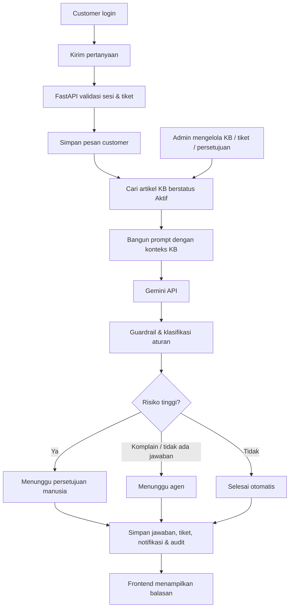

# V-TEKI Workspace — Gemini Backend

Prototype backend untuk front end V-TEKI Workspace. Stack: **FastAPI + SQLite + Gemini API**. Backend menyimpan akun, sesi login, tiket, riwayat chat, artikel Basis Pengetahuan, notifikasi, dan audit trail.

> **Penting:** akun dan artikel yang disertakan adalah data demo Bank Nusantara. Aplikasi ini tidak terhubung ke sistem bank sungguhan. Fitur persetujuan hanya mengubah status demo; tidak memblokir kartu atau memindahkan uang.

## 1. Kebutuhan

- Windows 10/11
- Python 3.11 atau lebih baru
- Koneksi internet untuk memanggil Gemini API
- Gemini API key dari [Google AI Studio](https://aistudio.google.com/apikey)

## 2. Instalasi di Windows

Buka terminal VS Code di folder `vteki_gemini`.

```powershell
cd backend
py -m venv .venv
.\.venv\Scripts\Activate.ps1
python -m pip install --upgrade pip
pip install -r requirements.txt
Copy-Item .env.example .env
```

Buka `backend/.env`, lalu isi `GEMINI_API_KEY`. Model default `gemini-2.5-flash` disimpan pada `GEMINI_MODEL`; jika model tersebut tidak tersedia untuk project/API key Anda, ganti dengan model Flash yang tercantum di dokumentasi Gemini API dan tersedia untuk akun Anda. Jangan taruh API key di `frontend/index.html` atau commit file `.env` ke Git.

Jalankan backend dari folder `backend`:

```powershell
uvicorn app.main:app --reload
```

Backend tersedia di `http://127.0.0.1:8000`. Dokumentasi endpoint interaktif: `http://127.0.0.1:8000/docs`.

Buka terminal VS Code kedua, dari folder proyek jalankan frontend:

```powershell
cd frontend
py -m http.server 5500
```

Buka `http://127.0.0.1:5500`. Jangan buka HTML langsung dengan `file://` karena browser dapat membatasi request API.

## 3. Akun demo

| Peran | Email | Kata sandi |
|---|---|---|
| Admin | `admin@vteki.id` | `admin123` |
| Customer | `customer@vteki.id` | `cust1234` |

Ganti atau hapus akun demo sebelum deployment. Database SQLite dibuat otomatis sebagai `backend/vteki.db` ketika server pertama kali dijalankan.

## 4. Workflow sistem

1. **Login & otorisasi** — frontend mengirim email/kata sandi ke `POST /api/auth/login`. Backend memverifikasi hash kata sandi dan mengembalikan bearer token. Setiap endpoint privat memeriksa token dan role.
2. **Customer membuat pesan** — frontend mengirim `message` dan opsional `case_id` ke `POST /api/chat`. Backend membuat tiket jika belum ada, lalu menyimpan pesan customer.
3. **Pencarian Basis Pengetahuan (RAG sederhana)** — backend mencocokkan kata dalam pertanyaan dengan judul, kata kunci, dan isi artikel berstatus `Aktif`. Artikel yang cocok dimasukkan sebagai konteks prompt.
4. **Gemini menghasilkan jawaban** — backend memanggil Gemini melalui SDK `google-genai`. Instruksi sistem membatasi jawaban pada fakta KB dan melarang klaim bahwa tindakan akun sudah dijalankan.
5. **Klasifikasi dan guardrail** — backend menandai komplain sebagai `Menunggu agen`, serta permintaan refund/blokir/perubahan data sebagai `Menunggu persetujuan`. Ini adalah aturan sederhana berbasis kata kunci, bukan klasifikasi ML yang terlatih.
6. **Simpan hasil** — balasan, status tiket, dan notifikasi disimpan ke SQLite. Jika tidak ada artikel yang cocok, jawaban menyatakan keterbatasan dan tiket diarahkan ke agen.
7. **Admin menangani kasus** — admin dapat melihat semua tiket, membalas sebagai agen, memeriksa permintaan berisiko, dan menyetujui/menolak permintaan demo.
8. **Admin mengelola KB & audit** — admin dapat menambah, mengubah, mengaktifkan, menjadikan draf, menghapus, atau mengimpor teks sebagai artikel. Aktivitas penting dicatat di audit trail.

### Diagram alur



## 5. Struktur program

```text
vteki_gemini/
├── README.md
├── frontend/
│   └── index.html             # UI login, dashboard, chat, KB, approval, audit
└── backend/
    ├── .env.example           # template konfigurasi rahasia
    ├── requirements.txt       # dependensi Python
    ├── vteki.db               # dibuat otomatis saat pertama dijalankan
    └── app/
        ├── __init__.py
        ├── config.py          # membaca .env dan konfigurasi model
        ├── db.py              # skema SQLite dan data demo
        ├── security.py        # hash password, sesi bearer, role, audit
        └── main.py            # REST API, RAG, integrasi Gemini, workflow tiket
```

## 6. Endpoint penting

| Endpoint | Akses | Fungsi |
|---|---|---|
| `POST /api/auth/login` | Publik | Login |
| `GET /api/auth/me` | Login | Profil sesi |
| `POST /api/auth/logout` | Login | Hapus sesi |
| `GET/POST /api/cases` | Login | Daftar/buat tiket |
| `GET /api/cases/{id}/messages` | Pemilik atau Admin | Riwayat pesan |
| `POST /api/chat` | Login | Chat Gemini + KB |
| `GET/POST /api/knowledge` | Admin | Daftar/tambah artikel |
| `PUT/DELETE /api/knowledge/{id}` | Admin | Ubah/hapus artikel |
| `POST /api/knowledge/import-text` | Admin | Impor teks sebagai artikel |
| `GET /api/notifications` | Login | Daftar notifikasi |
| `GET /api/admin/dashboard` | Admin | Ringkasan operasional |
| `GET /api/admin/approvals` | Admin | Permintaan yang menunggu persetujuan |
| `POST /api/admin/approvals/{id}` | Admin | Setujui/tolak permintaan demo |
| `POST /api/admin/cases/{id}/reply` | Admin | Balasan agen manusia |
| `GET /api/admin/audit` | Admin | Audit trail |
| `GET /api/health` | Publik | Status server dan konfigurasi Gemini |

## 7. Catatan teknis dan batasan

- Implementasi retrieval saat ini **RAG sederhana berbasis pencocokan kata**, belum memakai embedding/vector database. Untuk skala besar, pertimbangkan Gemini Embeddings dan vector store.
- Tidak ada integrasi dengan sistem core banking, OTP sungguhan, payment gateway, email, atau SMS.
- Akun demo dan data KB bersifat contoh; jangan gunakan untuk layanan pelanggan produksi.
- Sebelum deployment, tambahkan HTTPS, rate limiting, proteksi brute-force, kebijakan retensi data, secret manager, migrasi database, pengujian, dan validasi keamanan. Ganti `APP_SECRET`, kata sandi demo, CORS, serta mekanisme sesi sesuai lingkungan deployment.
- Jangan pernah meminta atau menyimpan PIN, password, OTP, CVV, atau nomor kartu penuh dalam chat.

## Referensi

- Gemini API model: https://ai.google.dev/gemini-api/docs/models
- Gemini API Python SDK: https://googleapis.github.io/python-genai/
- FastAPI: https://fastapi.tiangolo.com/
