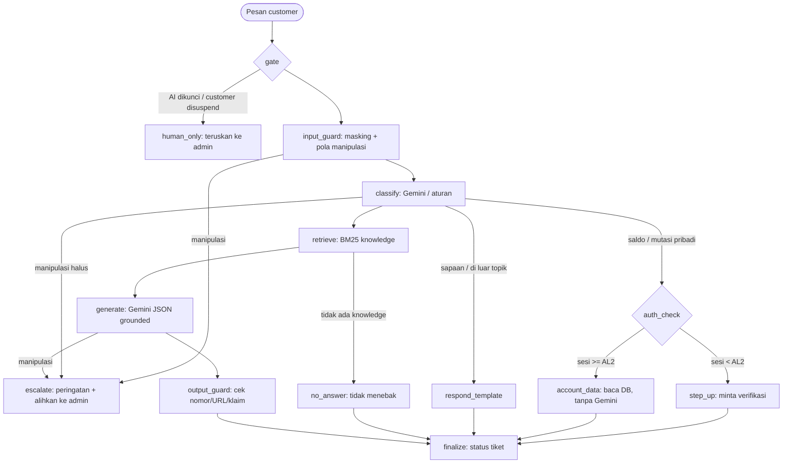

# V-TEKI Workspace — Chatbot Layanan Pelanggan (Gemini + LangGraph)

Prototipe customer service AI. Stack: **FastAPI + SQLite + Gemini API + LangGraph**. Knowledge base saat ini memakai dokumen `knowledge/BCA_Knowledge_Base_Customer_Service.md`.

> **Penting:** ini prototipe independen, **bukan kanal resmi BCA**, dan tidak terhubung ke sistem bank. Persetujuan admin hanya mengubah status demo; tidak ada kartu yang diblokir atau uang yang dipindahkan.

## Yang baru di versi 2

| Fitur | Ringkasnya |
|---|---|
| **Knowledge dari file** | Unggah `.md`, `.txt`, `.pdf`, `.docx` (bisa banyak sekaligus, drag & drop). Dokumen dipecah otomatis per judul `##`/`###` menjadi bagian kecil lengkap dengan kategori, kata kunci, URL sumber, dan validitas. |
| **Versi dokumen** | Unggah file dengan nama sama = versi baru (bagian lama diganti). File identik dilewati. Ada pratinjau, unduh, indeks ulang, aktif/nonaktif per dokumen atau per bagian. |
| **Folder `knowledge/`** | File di folder ini otomatis diimpor saat backend start (bila baru/berubah). File yang dihapus dari folder → dokumennya otomatis **Nonaktif** (tidak dihapus); dikembalikan → aktif lagi. |
| **Jawaban tidak sembarangan** | Pencarian BM25 + stemmer bahasa Indonesia + ambang skor. Gemini wajib mengembalikan `grounded` + `source_ids`; jika tidak ada sumber → AI bilang belum tahu dan tiket diteruskan ke agen. Sumber jawaban tampil di chat. |
| **Guardrail anti-manipulasi** | Deteksi prompt injection, jailbreak, roleplay, klaim admin, tag sistem palsu, teks tersamar (spasi/leetspeak/zero-width) + klasifikasi Gemini. Jika terdeteksi: AI berhenti, customer diberi **peringatan**, percakapan **langsung dialihkan ke admin** & dikunci, admin dinotifikasi. Setelah 3 peringatan, AI dinonaktifkan untuk customer tsb. |
| **Output guard** | Jawaban AI diblok bila menyebut nomor/URL yang tidak ada di knowledge, meminta OTP/PIN, mengaku sudah memblokir/refund, atau membocorkan instruksi. |
| **Masking data rahasia** | OTP, PIN, password, CVV, dan nomor kartu (cek Luhn) disamarkan sebelum disimpan atau dikirim ke Gemini. |
| **Routing LangGraph** | Lihat diagram di bawah. Rute tiap pesan terlihat oleh admin di halaman Kasus. |
| **Autentikasi AL0–AL3** | Customer membuktikan dirinya (OTP, PIN transaksi) sebelum melihat saldo/mutasi atau mengajukan tindakan berisiko. Lihat bagian 4b. |

## 1. Instalasi (Windows)

Paling mudah: klik dua kali **`setup.bat`**, isi `GEMINI_API_KEY` di `backend\.env`, lalu klik **`start_all.bat`**.

Manual:

```powershell
cd backend
py -m venv .venv
.\.venv\Scripts\Activate.ps1
pip install -r requirements.txt
Copy-Item .env.example .env     # lewati jika .env sudah ada
.\.venv\Scripts\python.exe -m uvicorn app.main:app --reload
```

Terminal kedua: `cd frontend` lalu `py -m http.server 5500`, buka http://127.0.0.1:5500.

> **Upgrade dari versi lama:** cukup jalankan ulang `pip install -r requirements.txt` (ada paket baru: `langgraph`, `python-multipart`, `pypdf`, `python-docx`, `PySastrawi`). Database lama dimigrasi otomatis: kasus, pesan, dan audit tetap utuh; artikel lama (demo Bank Nusantara dan impor teks satu-blok) dijadikan **Draf** dengan kategori "Arsip lama" — tidak dihapus.

## 2. Akun demo

| Peran | Email | Kata sandi |
|---|---|---|
| Admin | `admin@vteki.id` | `admin123` |
| Customer | `customer@vteki.id` | `cust1234` (HP demo `081234567890`, **PIN transaksi `246810`**, rekening demo saldo Rp 12.450.000) |

## 3. Mengelola knowledge

1. Login Admin → **Basis Pengetahuan**.
2. Seret file ke kotak unggah (atau klik *Pilih file*). Klik **Pratinjau pemecahan** untuk melihat hasil pecahannya sebelum disimpan, lalu **Unggah**.
3. Klik dokumen untuk melihat bagian-bagiannya; tiap bagian bisa diedit (judul, kategori, jenis, status, validitas, URL sumber, kata kunci, isi).
4. Gunakan **Uji pencarian** untuk memastikan pertanyaan customer menemukan bagian yang benar sebelum dipakai.

**Agar dokumen baru terbaca baik**, ikuti pola file BCA:

```markdown
# Judul dokumen
**Organisasi:** Bank BCA                        ← nama organisasi di sapaan & prompt AI (opsional; bila tidak ada ditebak dari judul "... Bank X", bisa diubah lewat tombol Organisasi)
**Tanggal penyusunan:** 28 Oktober 2026        ← dibaca sebagai tanggal pemeriksaan
**Sumber utama:** https://...                   ← URL sumber default

## 0. Instruksi untuk AI Agent                  ← otomatis jenis "instruksi" (panduan perilaku AI)
## 2. Kanal bantuan resmi
### Halo BCA                                    ← tiap ### jadi satu bagian
## 7. FAQ
### Q1. Bagaimana cara menghubungi Halo BCA?    ← satu pertanyaan = satu bagian
## 9. Metadata yang disarankan untuk database   ← otomatis jenis "metadata" (tidak dipakai)
```

Jenis bagian:
- **fakta** — dicari & dipakai untuk menjawab.
- **instruksi** — judul seperti "Instruksi untuk AI", "Jika jawaban tidak ditemukan"; ditambahkan ke prompt sebagai panduan (tidak bisa mengalahkan aturan inti).
- **metadata** — disimpan, tidak pernah dipakai.

Bagian bertanda *dinamis* (biaya, limit, nomor, ketentuan) membuat AI mengingatkan customer untuk memverifikasi di sumber resmi.

## 4. Routing LangGraph



| Intent | Status tiket |
|---|---|
| Inquiry terjawab dengan sumber | Selesai otomatis |
| Inquiry tanpa knowledge / jawaban diblok | Menunggu agen |
| Komplain | Menunggu agen (prioritas tinggi) |
| Laporan penipuan / kartu hilang | Menunggu agen (prioritas tinggi, risiko) |
| Permintaan tindakan (blokir, refund, ubah data) | Menunggu persetujuan |
| Upaya manipulasi AI | **Dialihkan ke admin** (AI dikunci di kasus itu) |
| Info rekening pribadi (saldo/mutasi) | AL2+: Selesai otomatis · di bawah AL2: status tidak berubah, diminta verifikasi |

## 4b. Tingkat autentikasi customer (AL0–AL3)

| Level | Cara mencapai | Boleh | Masa berlaku |
|---|---|---|---|
| **AL0** Anonim | belum login | tidak bisa chat (API membalas 401) | – |
| **AL1** Login akun | email + kata sandi | info umum dari knowledge, membuat & melihat tiket sendiri | selama sesi |
| **AL2** Terverifikasi OTP | AL1 + kode OTP 6 digit ke nomor HP terdaftar | lihat **saldo & mutasi rekening milik sendiri** | 15 menit |
| **AL3** Terverifikasi kuat | AL2 + PIN transaksi | ajukan tindakan berisiko (blokir, ubah data, refund) yang **bisa disetujui admin** | 5 menit |

Cara pakai (customer): tanya "Berapa saldo rekening saya?" → AI meminta verifikasi → klik **Verifikasi identitas** (atau lencana 🛡 AL di kanan atas) → **Kirim kode OTP** → masukkan kode → pertanyaan dikirim ulang otomatis dan saldo tampil. Untuk "Tolong blokir kartu saya", lanjutkan ke langkah PIN (AL3); tanpa AL3 tombol **Setujui** di menu Persetujuan admin terkunci.

Pengaman yang diterapkan:
- Level disimpan **per sesi login** di server, bukan dari isi chat. Klaim "saya sudah terverifikasi" di chat tidak berpengaruh; logout/login ulang kembali ke AL1.
- OTP & PIN dimasukkan di dialog khusus, **tidak pernah lewat chat** dan tidak dikirim ke Gemini. OTP & PIN disimpan sebagai hash.
- OTP terikat ke sesi yang memintanya, berlaku 3 menit, hangus setelah 3x salah, maks. 3 permintaan per 10 menit.
- PIN salah 3x → verifikasi PIN dikunci 15 menit, verifikasi sesi dicabut, admin dinotifikasi.
- Data rekening dibaca kode langsung dari database (node `account_data`), **tidak pernah dikirim ke Gemini**, nomor rekening disamarkan, dan **tidak disimpan di riwayat chat** (riwayat hanya menyimpan penanda; admin pun tidak melihat saldonya).
- Setiap verifikasi & akses saldo tercatat di Audit Trail.

> **Mode demo:** tanpa SMS gateway, kode OTP ditampilkan di layar (`OTP_DEMO_MODE=true`). Rekening & transaksi adalah data fiktif (tabel `bank_accounts`, `bank_transactions`). Untuk produksi: set `OTP_DEMO_MODE=false`, kirim OTP lewat SMS/WhatsApp gateway, dan ganti data demo dengan integrasi core banking.

Status "menunggu" tidak turun kembali ke "Selesai otomatis" hanya karena customer bertanya hal lain.

## 5. Guardrail — alur untuk admin

- Menu **Guardrail** menampilkan semua kejadian (pola manipulasi, deteksi AI, jawaban AI yang diblok, data rahasia yang disamarkan) dan daftar customer yang punya peringatan.
- **Konfirmasi** = deteksi benar. **Salah deteksi** = peringatan customer dikurangi dan AI di kasus itu aktif lagi.
- **Pulihkan akses AI & reset peringatan** untuk customer yang telah mencapai batas.
- Di **Kasus & Percakapan**, tombol **Aktifkan AI kembali** membuka kunci AI untuk satu kasus.

## 6. Konfigurasi (`backend/.env`)

| Variabel | Default | Fungsi |
|---|---|---|
| `ORG_NAME` | `BCA` | Nama organisasi **cadangan**. Nama utama diambil otomatis dari dokumen knowledge yang aktif (lihat bagian 3), jadi ikut berganti saat knowledge diganti. |
| `LLM_CLASSIFIER` | `true` | Klasifikasi + deteksi manipulasi dengan Gemini (1 panggilan tambahan/pesan). `false` = hemat kuota, aturan pola saja. |
| `KB_MIN_SCORE` | `3.0` | Ambang relevansi. Naikkan jika AI memakai bagian yang kurang cocok; turunkan jika terlalu sering "belum tahu". |
| `KB_SCORE_REF_DOCS` | `20` | `KB_MIN_SCORE` berlaku penuh bila bagian aktif ≥ angka ini; untuk knowledge lebih kecil ambang diturunkan proporsional agar dokumen kecil tetap bisa menjawab. |
| `KB_TOP_K` | `4` | Jumlah bagian maksimum yang dikirim ke Gemini. |
| `GUARDRAIL_MAX_STRIKES` | `3` | Batas peringatan sebelum AI dinonaktifkan untuk customer. |
| `KNOWLEDGE_AUTO_SYNC` | `true` | Impor otomatis isi folder `knowledge/` saat start. |
| `MAX_UPLOAD_MB` | `5` | Batas ukuran file unggahan. |
| `OTP_DEMO_MODE` | `true` | Tampilkan kode OTP di layar (prototipe tanpa SMS gateway). **Wajib `false` di produksi.** |
| `AL2_TTL_MIN` / `AL3_TTL_MIN` | `15` / `5` | Masa berlaku verifikasi OTP / PIN. |
| `OTP_TTL_SEC`, `OTP_MAX_ATTEMPTS`, `OTP_MAX_REQUESTS` | `180`, `3`, `3` | Masa berlaku kode, batas salah, batas permintaan per 10 menit. |
| `PIN_MAX_ATTEMPTS` / `PIN_LOCK_MIN` | `3` / `15` | Batas PIN salah dan lama penguncian. |

## 7. Pengujian

```powershell
cd backend
.\.venv\Scripts\python.exe -m tests.smoke_test
```

30 uji end-to-end (upload & versi, pencarian, routing, guardrail, masking, pemulihan admin) dengan Gemini **tiruan** — tidak memakai kuota dan tidak menyentuh `vteki.db`.

Uji pergantian knowledge (40 uji: ganti dokumen, versi baru, edit bagian, riwayat percakapan, nama organisasi, folder `knowledge/`):

```powershell
.\.venv\Scripts\python.exe -m tests.knowledge_switch_test
```

Uji routing & autentikasi AL0–AL3 (57 uji: rute tiap jenis pesan, OTP/PIN, kedaluwarsa, penguncian, isolasi data antar customer, data rekening tidak sampai ke Gemini):

```powershell
.\.venv\Scripts\python.exe -m tests.routing_auth_test
```

### Mengganti knowledge dengan aman
1. Unggah dokumen baru, lalu **nonaktifkan** dokumen lama (dua dokumen aktif = jawaban bisa bercampur).
2. Nama organisasi di sapaan/prompt otomatis mengikuti dokumen aktif.
3. Jawaban AI lama yang sumbernya dinonaktifkan/diedit otomatis dikeluarkan dari riwayat yang dikirim ke Gemini.

## 8. Struktur program

```text
VTEKI_Chatbot/
├── knowledge/                      # file knowledge (otomatis diimpor saat start)
├── frontend/index.html             # UI customer & admin
└── backend/
    ├── requirements.txt
    ├── .env.example
    ├── tests/smoke_test.py         # uji end-to-end (LLM ditiru)
    └── app/
        ├── main.py                 # REST API & penyimpanan hasil
        ├── agent.py                # graph LangGraph + prompt
        ├── identity.py             # tingkat autentikasi AL0–AL3, OTP, PIN, data rekening demo
        ├── knowledge.py            # parser file, chunking, BM25
        ├── guardrails.py           # deteksi manipulasi, masking, output guard
        ├── llm.py                  # pembungkus Gemini (JSON + model cadangan)
        ├── db.py                   # skema SQLite + migrasi
        ├── security.py             # hash password, sesi, role, audit
        └── config.py
```

## 9. Endpoint baru

| Endpoint | Fungsi |
|---|---|
| `POST /api/knowledge/upload` | Unggah satu/banyak file (multipart: `files`, `status`, `mode`, `category`) |
| `POST /api/knowledge/preview` | Pratinjau pemecahan file tanpa menyimpan |
| `GET /api/knowledge/documents` · `GET/PATCH/DELETE /api/knowledge/documents/{id}` | Kelola dokumen |
| `GET /api/knowledge/documents/{id}/download` · `POST …/reindex` | Unduh teks asli · pecah ulang |
| `POST /api/knowledge/search-test` | Uji bagian mana yang dipakai untuk sebuah pertanyaan |
| `GET /api/admin/guardrail` · `POST /api/admin/guardrail/{id}/review` | Kejadian guardrail & tinjauan |
| `POST /api/admin/users/{id}/restore-ai` · `POST /api/admin/cases/{id}/unlock-ai` | Pulihkan akses AI |
| `GET /api/admin/graph` | Diagram LangGraph (Mermaid) |
| `GET /api/auth/levels` · `GET /api/auth/level` | Kebijakan AL0–AL3 · level sesi saat ini |
| `POST /api/auth/verify/otp/request` · `…/otp/confirm` | Minta & konfirmasi OTP → AL2 |
| `POST /api/auth/verify/pin` · `…/revoke` | PIN transaksi → AL3 · akhiri verifikasi |
| `GET /api/accounts` · `GET /api/accounts/{id}/transactions` | Saldo & mutasi rekening sendiri (wajib AL2) |

Endpoint lama tetap tersedia. Dokumentasi interaktif: http://127.0.0.1:8000/docs

## 10. Batasan

- Guardrail berlapis menekan risiko manipulasi, tetapi tidak ada guardrail yang 100% kebal; admin tetap perlu meninjau kejadian.
- Pencarian memakai BM25 (kata), belum embedding/vektor. Untuk ribuan dokumen, pertimbangkan Gemini Embeddings + vector store.
- Pada free tier Gemini, data input dapat dipakai Google untuk peningkatan produk — jangan masukkan data nasabah asli.
- Sebelum produksi: HTTPS, rate limiting, ganti akun demo, secret manager, dan kebijakan retensi data.
